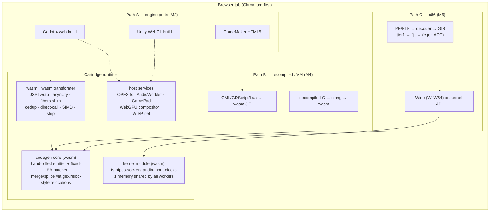

# Nested WASM JITs: v86, GEX, Firefox‑wasm
### A case study of three production "JIT that emits WebAssembly" systems, and a proof‑of‑concept architecture for game web ports

*Research date: November 2026. All source references verified against the current trees of [copy/v86](https://github.com/copy/v86), [HeyPuter/gex](https://github.com/HeyPuter/gex) and [HeyPuter/firefox-wasm](https://github.com/HeyPuter/firefox-wasm).*

---

## 1. TL;DR

- **The shared innovation** in all three projects is *nested code generation*: a program running inside WebAssembly compiles guest code (x86 machine code, ARM64 machine code, recovered C functions, or JavaScript) **to new WebAssembly modules at runtime**, then executes them with the browser's own optimized wasm pipeline. The browser is the JIT backend.
- **v86** proves the technique for *machine code translation* (x86 → wasm, page-granular modules, interpreter-first tiering).
- **gex** is the state of the art for *running real games*: a static recompiler with a three-tier pipeline (basic blocks → function JIT → C/clang AOT), its own Linux-kernel ABI in wasm, guest virtual addresses as raw wasm memory offsets (memory64), Wine for Windows games, and Mesa-on-WebGPU for OpenGL up to 4.6.
- **firefox-wasm** proves the technique at the *largest possible scale* — a whole browser with its own JS engine inside wasm — using Emscripten + JSPI, with an experimental **JS→wasm JIT** replacing SpiderMonkey's disabled native JIT.
- For a game-focused PoC, the winning design is a **"cartridge runtime"**: one wasm codegen core + one wasm→wasm transformer + host services (fs/audio/input/GPU/net), with three ingestion paths: (A) adapters for existing **Godot/Unity/GameMaker web builds** (compat + perf injection), (B) **recompiled-C / VM-bytecode** games lifted to wasm, and (C) later, **x86 Windows binaries** via a gex-style recompiler + Wine.

---

## 2. Why "JIT inside WebAssembly" is a special problem

Browsers forbid native code generation from wasm (no `mmap`/`W^X` memory, no page protection, no patching). v86's author states the constraint set that every nested JIT must live with (`v86/docs/how-it-works.md`):

1. **Structured control flow only** — no arbitrary jumps in wasm output; graphs must be "stackified" into `block`/`loop`/`br`.
2. **No register control** — you cannot keep hardware registers in wasm locals across function boundaries.
3. **No `mmap`** — guest paging must be fully emulated in software.
4. **No patching** — code cannot be overwritten in place; invalidation means dropping and regenerating modules.
5. **Module generation is slow but asynchronous** — `WebAssembly.compile` is async, so codegen can overlap execution.
6. **Per-module memory overhead** — only a few thousand generated modules are viable; granularity must be coarse.

Everything the three projects do differently is a different answer to the same six constraints.

---

## 3. Case study 1 — v86: the x86→wasm JIT

**What it is.** An x86 PC emulator (Pentium‑4-class CPU with SSE3, VGA/SVGA, IDE, SB16, NE2000, virtio) running Windows 1.01→8, DOS, Linux, *etc.* Machine code is translated to wasm at runtime; the JIT is written in Rust targeting `wasm32-unknown-unknown` ([v86 Readme](https://github.com/copy/v86)).

**Execution model: interpreter first, JIT on hotness.** Blocks first run in the interpreter, which records *entry points* (targets of calls/indirect jumps) and accumulates **hotness per physical page**. At `JIT_THRESHOLD = 200_000` (jit.rs:76), the whole page — plus up to `MAX_PAGES = 3` reachable pages — is analyzed and compiled as **one wasm module**. Tiering keeps cold code free and concentrates codegen where it pays.

**Module shape.** The generated module is a *single wasm function* containing every basic block of those pages. Entry is a `br_table` dispatcher indexed by an `initial_state` parameter; internal control flow is stackified into `WasmStructure::{BasicBlock, Dispatcher, Loop, Block}` (control_flow.rs:80). Fewer than `BRTABLE_CUTOFF = 10` successors become an `if/else` chain; more become a `br_table`. A loop-safety counter (`instruction_counter` vs `cpu::LOOP_COUNTER`) guards against `STI`-style infinite loops (jit.rs:1232-1245).

**State representation.** There are no wasm globals: the 8 GP registers live at fixed offsets in guest linear memory (`cpu/global_pointers.rs`) and are **loaded into 8 wasm locals at module entry** and written back at exit (`jit_generate_module`, jit.rs:1219‑1224). Inside a module, generated code tracks operands as `WasmLocal`s and fuses flag producers/consumers (the `Instruction::{Cmp,Sub,Add,...}` enum, jit.rs:304‑337) — e.g. `cmp eax,52` + `setb al` collapses to one comparison — on top of v86's *lazy flags* representation.

**Memory access.** Every guest load/store compiles inline to the `gen_safe_read` pattern: read the 4 MB software TLB (`tlb_data`, 1M entries); if the entry is valid and the access stays within the page, do a **direct wasm load** at the translated address; otherwise call the slow path which walks page tables and can raise a fault (how-it-works.md:41‑55). The fast path is a handful of wasm instructions.

**Dispatch & linking.** Each module is installed at a slot of one shared wasm table (`WASM_TABLE_SIZE = 900`, jit.rs:82) and entered via `call_indirect`. There is **no cross-module linking**: an indirect jump leaves the module to the main loop, which consults `tlb_code[page] → CachedCode{wasm_table_index, initial_state}` and a per-page `state_table[4096]` mapping code offsets to dispatcher states (jit.rs:400‑428). Cache validity is keyed by *physical page* + 4 `CachedStateFlags` bits (is‑32bit, SS‑32, CPL3, flat segments — state_flags.rs), so the same physical code compiles separately per CPU mode.

**Faults & invalidation.** Every potentially-faulting operation branches to a generated `exit_with_fault` label with `eip`/`previous_eip` already stored, resuming in the interpreter. Self-modifying code is handled by **page-granular dirty sweeps**: `jit_dirty_page_ctx` (jit.rs:2242) removes the page's `PageInfo`, frees its table slot(s) back to a free list, clears matching `tlb_code` entries, and — crucially for the async pipeline — marks an in-flight compilation `CompilingWritten` so a module whose page changed during `WebAssembly.compile` is discarded on completion.

**Tooling.** Instruction semantics live in one table (`gen/x86_table.js`) from which scripts generate *both* the interpreter and the JIT (plus nasm tests); JIT output is verified against hand-written `.wast` expect tests (`tests/expect/tests/*.wast`). FPU uses Berkeley SoftFloat for exact 80-bit floats (how-it-works.md:80).

**What to take from v86:** page-granular module batching (amortizes instantiation overhead), interpreter-first tiering with hotness counters, registers-in-locals with write-back at exit, inline TLB fast-path, physical-page + mode-flags cache keys, async codegen with compile-race detection, table-slot dispatch, and wast-golden-test infrastructure.

---

## 4. Case study 2 — gex: the static recompiler + kernel ABI

**What it is.** gex (Puter, AGPL‑3.0) runs **unmodified Linux programs (AArch64, x86‑64, i386) and Windows programs (through 64‑bit Wine with WoW64)** in a browser — not by emulating a PC, but by implementing **the Linux kernel ABI itself in Rust, compiled to wasm**. A guest "sees" real syscalls; there is no guest OS to boot. This is the decisive architectural difference from v86, and the reason it scales to modern games.

**The pipeline** (`gex/README.md:52`):

```text
guest ELF/PE ─▶ gex-ld ─▶ gex-xlate ─▶ gex-isa(-x86) ─▶ gex-lift(-x86) ─▶ gex-emit ─▶ wasm
                load      discover      decode            GIR (SSA IR)      tier 1
                                            │
                                            ├─▶ gex-fjit   function JIT (GIR → wasm)
                                            └─▶ gex-cgen   function tier (GIR → C → clang → wasm)
```

**Three tiers, one ABI** (README:64‑69):

- **Tier 1** (`gex-emit/tier1.rs`, 6.1k lines): every guest *basic block* becomes a wasm function with the uniform signature `(ctx: i32) -> ()`. Direct successors are reached with **`return_call`** (tail calls); computed successors via **`return_call_indirect` through the PC-indexed dispatch table**. Because wasm tail calls do not grow the wasm stack, guest call depth never appears as wasm stack depth, and *any* 4‑byte‑aligned guest address can be promoted to an entry point later without retranslating. Two local optimizations matter: guest registers are **cached in wasm locals for the whole block** (loaded at most once, stored back at most once), and value locals are **recycled with last-use information** (tier1.rs:1‑16).
- **Function JIT** (`gex-fjit`): gex-xlate *recovers guest functions* (control-flow recovery from blocks, symbols, call targets; jump tables stay `Unresolved` and fall back to tier‑1 — `gex-cgen/recover.rs:1‑11`). Each recovered function is emitted as **one wasm function directly from GIR** — no clang — using the same `F_body` ABI `(ctx, depth, need, ret) -> i32` as the AOT tier, with **call inlining** and **loop outlining** (`gex-fjit/lib.rs:1‑24`). Every function checks the `PAGE_GEN` word of each page it covers **on entry** — a per-page generation counter that makes self-modifying-code invalidation a cheap compare-and-bail instead of a sweep.
- **Function tier AOT** (`gex-cgen` + `gex-split`): the same recovered functions are lowered **GIR → C → clang → wasm** ahead of time, giving native-optimizer-quality output; `gex-split` cuts units into hot/cold parts and `gex-units` decides what ships. All three tiers **call each other through one function table**.

**Zero-cost memory model.** gex is the kernel, so *it* allocates every guest address: **guest virtual address == wasm linear-memory offset** — a guest load is a plain wasm load with no translation arithmetic (README:61‑64). 64‑bit guests run on **shared memory64**; the dispatch table becomes a table64 (`gex-emit/wasm.rs:764, 909, 441`). The 32‑bit layout reserves one page below 4 GiB (`GUEST_MEM_BYTES = 0xFFFF_0000`) so wild pointers hit `POISON_ADDR = 0xFFFF_FFF0` and fault as SIGSEGV; page 0 stays unmapped so null derefs trap (`gex-abi/lib.rs:52‑56, 204`).

**Self-modifying code & discovery.** Unlike v86, **discovery is never load-bearing**: code the translator did not predict lands on a stub that translates on demand — a wrong guess costs time, never correctness (README:70‑73). SMC is handled by the `PAGE_GEN` dispatch-directory mechanism (`gex-abi/lib.rs:153‑181`) plus a patched-pages bitmap, tested down to `smc-race` and `smc-direct-jump` fixtures.

**Ahead-of-time ejection.** `gexc run --record` records what a run loaded and executed; `gexc eject` turns the recording into a project that builds *everything* AOT and ships as a **static site importable as a JS library** (`site/eject-site.mjs`). This is how gex gets around runtime codegen cost entirely for shipped games.

**Host stack.** The shared kernel module (`hosts/kernel/src/lib.rs`, 5k lines) holds the process table, VFS, pipes and sockets in **one wasm module + memory shared by every Worker of every process**, so "a syscall stays a direct call rather than a message and a wait" (lib.rs:4‑9); guest buffers live in the process's own memory, imported by the kernel as a second memory and crossed with `memory.copy`. Each guest thread is a **Worker on shared memory** (needs COOP/COEP) — or, in the single-thread build, **a fiber in one Worker** that runs on any static host (`page/README.md:19‑27`). The kernel provides 1024 × 256 KiB worker stacks. Graphics: `gex-wayland` compositor + `gex-xwm`, rootless **Xwayland compiled to wasm**, and guest GL calls routed through gex's `libGL/libEGL` into **Mesa compiled to wasm drawing on WebGPU** (Gallium `gex_wgpu`) — **desktop GL up to 4.6** (README:37‑43). Extras: exact x87 80‑bit math (`gex-f80`), x86‑TSO memory ordering, snapshots, a `gexcc` wasm32 C/C++ compiler for wasm-native Linux guests, and audio/gamepad services in the kernel (`audio.rs`, `joy.rs`).

**What to take from gex:** block-per-function + `return_call` chaining (no wasm stack growth, late entry points), an SSA IR (GIR) shared by all tiers, function recovery as the unit of optimization, the tier ladder **tier‑1 → function JIT → C/clang AOT**, guest-VA-as-memory-offset with memory64, PAGE_GEN invalidation, kernel-ABI-as-library instead of OS emulation, record/eject AOT packaging, and a real game-grade GPU/audio/input host.

---

## 5. Case study 3 — firefox-wasm: a browser inside the browser

**What it is.** Gecko (the whole engine, all UI components, and SpiderMonkey) compiled to WebAssembly with **Emscripten 6.0.1**, loadable inside another browser tab. The build shallow-clones a **pinned fork of Firefox itself** (`HeyPuter/firefox` @ `2e1e835a…`, Makefile:47‑48) and drives `mach build` through `mozconfig.full.emscripten`.

**How the engine is adapted** (verified in the two mozconfigs and Makefile):

- `--disable-jit` — SpiderMonkey's native JIT cannot run inside wasm; JS first executes on the **Portable Baseline Interpreter** (`--enable-portable-baseline-interp(-force)`), whose **PBL hooks** the JS→wasm JIT uses for deopt-resume (`WasmJitResumeViaPBL`, mozconfig.js.emscripten:9‑17).
- **JS→wasm JIT (experimental):** hot JS functions are compiled to wasm modules at runtime — the same "browser as backend" trick as v86/gex, applied to JavaScript. README: *"an attempt at a JS→WASM JIT… not usable on many websites"*, toggled off with `GECKO_NOWASMJIT=1`.
- **Nested wasm runs interpreted:** content wasm executes on an in-process wasm interpreter (`GECKO_WASM_INTERP`) since the engine cannot JIT wasm-to-native.
- **JSPI is required** (`wasm_js_promise_integration`) — synchronous browser APIs inside the async host are made possible by stack switching (confirmed by the HN thread and the `about:config` requirement).
- Threading via emscripten **`-pthread`** (Workers + shared linear memory); **`-msimd128`** maps SSE intrinsics in Skia/image/media/qcms paths to real wasm SIMD; no IPC/e10s (single-process mode); `libxul.so`'s `-shared` link SIGSEGVs in wasm-ld so `relink-engine-r.sh` relinks with `-r`, and optimization is delegated to **`wasm-opt -O3`** over the final module (optional engine ThinLTO needs >54 GiB RAM).
- Networking via the **WISP protocol**: tabs' TCP/UDP multiplexed over one WebSocket to a relay; TLS done in-wasm by OpenSSL; video via a WebCodecs bridge; audio via `audio-out.js`; the whole thing ships as an embeddable ESM package (`gecko.js/`).

**Why it matters here:** it proves nested JIT *and* nested-wasm execution at a scale of tens of millions of lines, and it is a working recipe for **JSPI-driven synchronization**, worker-pool threading, and SIMD-mapped rendering inside wasm — all directly reusable for game runtimes. Its honest status (JIT "not usable on many websites", single-process sandbox degradation, RAM pressure on 1‑2 GB devices) also calibrates expectations.

---

## 6. Comparison

| | **v86** | **gex** | **firefox-wasm** |
|---|---|---|---|
| Guest code | x86 machine code | x86/ARM64 machine code + wasm32 | JavaScript (+ nested wasm) |
| Guest environment | full PC emulation (BIOS, devices) | Linux kernel ABI in wasm (+ Wine for PE) | full Gecko engine in wasm |
| Translation granularity | page-batched modules, 1 function each, stackified | function per basic block, then per recovered function | function per hot JS function |
| Entry into generated code | `call_indirect` via 900-slot table + `br_table` dispatcher | `return_call` / `return_call_indirect` via PC-indexed dispatch table | SpiderMonkey PBL resume hooks |
| IR | generated 1:1 lowering + fusion | GIR (SSA) shared by all tiers | SpiderMonkey MIR → wasm backend |
| Tier ladder | interpreter → wasm (hotness 200k) | tier‑1 → function JIT → GIR→C→clang AOT | PBL interpreter → JS→wasm JIT |
| State storage | registers in linear memory, cached in locals per module | registers in ctx, cached in locals per block/function | JS frames, wasm locals |
| Memory model | software TLB + inline fast path | guest VA == linear offset (memory64), poison page | Emscripten wasm32, `-pthread` |
| SMC/invalidation | page dirty sweep + compile-race discard | PAGE_GEN per-page generation checked on entry | (n/a — no native codegen) |
| Linking across modules | none (exit to main loop) | one function table across all tiers | n/a |
| Codegen API | hand-rolled wasm binary writer (`wasmgen/wasm_builder.rs`) | hand-rolled writer covering MVP + tail calls + threads + reftypes (`gex-emit/wasm.rs:8‑10`) | LLVM/emcc + wasm-opt; runtime emission in the fork |
| Codegen location | inside wasm, bytes passed to JS (`codegen_finalize`) | inside wasm (`gex-jit`) or AOT at build time | inside wasm (engine fork) |
| Packaging | disk images | record → eject → static site | ESM npm package |

---

## 7. The transferable playbook

1. **Emit raw wasm bytes yourself** — no wasm-as-text, no crates. Both v86 (`wasmgen/`) and gex (`gex-emit/wasm.rs`, "written by hand… because the translator has to run *inside* wasm") hand-roll the encoder, with **fixed-width (5‑byte) LEB fields** so offsets and function indices can be patched in place — the enabling trick for gex's runtime **module merging** via its `gex.reloc` relocation section (`gex-emit/wasm.rs:37‑44`).
2. **Batch modules, don't spam them** — v86 compiles ≤3 pages per module; gex splices many functions into one tier‑1 module. Instantiation overhead and engine-level function limits (v86 documents V8's ~7 MB function limit and `br_table` OOM bugs, jit.rs:64‑69) are the binding constraint.
3. **Tier deliberately**: interpreter/basic-block tier for coverage, function JIT for hot functions, clang AOT for shipping (gex); hotness thresholds with per-page counters (v86).
4. **Uniform signatures + one function table** so tiers and modules interoperate (gex); `return_call` keeps guest depth off the wasm stack and makes any address promotable to an entry point later.
5. **Cache registers in wasm locals** within a block/function; write back at exits (all three).
6. **Guest memory as raw memory64** when you control the loader (gex); software TLB with inlined fast path when you don't (v86); poison pages so wild pointers fault deterministically (gex `POISON_ADDR`).
7. **Make discovery non-load-bearing** — stubs that translate on demand (gex), missed-entry-point checks (v86).
8. **Generation counters for SMC** (gex `PAGE_GEN`) or page-dirty sweeps with async-compile race detection (v86 `CompilingWritten`).
9. **Golden tests**: v86 compares JIT output against hand-written `.wast`; gex runs guest C programs under qemu as the reference and diffs behavior on two hosts (browser + wasmtime).
10. **Syscalls as a library, not an OS** (gex kernel module); **JSPI for blocking-style APIs**; **workers-per-thread with a fiber fallback** for hosts without COOP/COEP (gex's two builds); **record → eject** to convert JIT work into AOT static-site builds.

---

## 8. PoC architecture: the "Cartridge" game runtime

### 8.1 Design goals (in priority order, per project intent)

1. **Compatibility first** — existing engine web builds (Godot, Unity WebGL, GameMaker HTML5, custom Emscripten ports) that *don't reliably work* on the open web (missing COOP/COEP headers, pthread builds, sync assumptions, memory limits, mobile browsers) must run, unmodified.
2. **Performance second** — the same builds get measurably faster via wasm→wasm optimization, AOT pre-warming, and (where a VM exists) bytecode→wasm JIT.
3. **x86 binaries later** — Windows-compiled games (the "decompiled x86 games" case) run through the same substrate via a gex-style recompiler + Wine, prioritizing the Win2000/XP+ catalog.

Non-goals for the PoC: DOS/BIOS-level PC emulation (v86 territory, only needed for pre‑1995 titles), multi-GPU feature parity, and replacing each engine's renderer — wrap the renderer, don't rewrite it.

### 8.2 Overview



The two reusable cores are (a) the **codegen core** — the v86/gex lesson that the encoder must be tiny, dependency-free and patchable in place — and (b) the **wasm→wasm transformer**, which is what makes Path A possible at all: gex already proves runtime **module merging** (`gex_emit::merge` + fixed-width LEB relocations) and **splicing** new functions into an existing module (`gex-cgen/splice.rs`), and firefox-wasm proves the Emscripten/JSPI packaging.

### 8.3 Path A — engine web ports (the priority)

Ship the engine build *unchanged*; the runtime patches imports and the module bytes:

| Failure mode on the open web | Runtime fix |
|---|---|
| pthread builds need `SharedArrayBuffer` → COOP/COEP headers most hosts can't set | **fiber scheduler shim**: intercept `emscripten_*thread` imports; run guest threads as fibers in one worker (gex's `dist-sp` build pattern), or real workers+shared memory when headers exist |
| blocking-style sync code that can't yield (audio callbacks, GL, file IO) | **JSPI wrappers** (`WebAssembly.Suspending`/`Promising`) on selected imports; **Asyncify-style transform** as the cross-browser fallback |
| `memory.grow` failures / 2 GB ceilings, fragmented heaps | module is re-emitted with a grow policy + optional **memory64** when the build can be re-based (gex runs both "flavours" behind `gex_abi::mem64()`) |
| broken/missing engine glue (audio unlock gesture, pointer lock, fullscreen, touch→mouse) | one import-patching layer per engine; kernel provides the browser side |
| asset loading, save games | kernel fs: OPFS + `pagefs`-style host passthrough (gex `hosts/kernel/pagefs.rs`) |
| GameMaker HTML5 = JS VM over GML bytecode, no wasm | **VM bytecode JIT**: profile the JS VM, lift hot GML functions to wasm with the codegen core (tier‑1 → function-JIT ladder, gex-style) |
| Performance: duplicate code across engine+game modules, indirect-call soup | **merge + dedup** into one module (gex splice), direct-call rewriting, dead-export stripping, `wasm-opt -O3` offline (the firefox-wasm approach) |

### 8.4 Path B — recompiled C and VM bytecode

Games reconstructed to C (Ghidra-style decompilations) compile with clang/Emscripten directly against the kernel ABI — no emulation at all; the codegen core is only needed for VM languages. For Godot/GDScript, GameMaker GML, Lua and (later) .NET CIL, the ladder is: **profile in the host VM → recover function boundaries (gex-xlate-style) → emit GIR → tier‑1 blocks → function JIT for hot functions**. v86's page-hotness counters (`JIT_THRESHOLD`, jit.rs:76) are the right triggering mechanism.

### 8.5 Path C — x86 binaries (later phase)

Follow gex, not v86: **kernel-ABI + Wine instead of a PC**. Linux ABI first (easiest: statically-linked musl targets), then **64‑bit Wine with WoW64** for PE games — gex demonstrates exactly this running in a browser. Graphics reach WebGPU via a Mesa-in-wasm Gallium driver or (cheaper, PoC-grade) a thin GL 1.x→WebGL2 bridge. Non-negotiables inherited from gex: exact x87 via an f80 crate, x86‑TSO for guest atomics, guest-VA-as-offset memory layout with poison page, `PAGE_GEN` invalidation, and the record→eject AOT path so shipped games do no runtime codegen at all.

### 8.6 Dispatch and invalidation — pseudo-code

**Tier‑1 block emission (gex-style, `gex-emit/tier1.rs` semantics):**

```rust
fn emit_block(b: &Block, ctx: &mut EmitCtx) {
    ctx.load_registers_to_locals(&b.live_in);          // cache: load ≤1×, store ≤1×
    for s in &b.stmts { ctx.emit_stmt(s); }            // guest load == raw wasm load (memory64)
    match &b.term {                                    // uniform (ctx:i32)->() signature
        Goto(t)          => ctx.return_call(entry(t)),          // tail call: no stack growth
        Branch{c, t, f}  => ctx.if_else(c,
                            |c| c.return_call(entry(t)),
                            |c| c.return_call(entry(f))),
        Call{callee, ..} => ctx.store_return_pc(); ctx.return_call(entry(callee)),
        Indirect         => ctx.return_call_indirect(ctx.pc / DISPATCH_PAGE_ENTRY),
        Syscall(n)       => ctx.return_call(kernel_import(n)),  // direct call, not a message
    }
    ctx.store_locals_back(&b.live_out);
}
```

**SMC invalidation (gex `PAGE_GEN` on entry):**

```wat
(func $f_body (param $ctx i32) (param $depth i32) (param $need i32) (param $ret i32) (result i32)
  ;; every page this function covers:
  (if (i32.ne (i32.load offset=$P1 (gen_word_addr $P1)) (i32.const $gen_P1))
      (then (return (i32.const $LEFT))))   ;; stale → bail to translator, retranslate
  ...
  (return (i32.const $PREDICTED_RETURN)))
```

A guest write to code memory bumps the page's generation word (`gex-abi` dispatch directory + patched-pages bitmap); stale functions cost one compare per covered page.

**Runtime codegen handshake (v86-style async finalize):**

```text
JIT (in wasm) writes module bytes into linear memory
  → import call codegen_finalize(table_index, phys_addr, flags, ptr, len)
  → JS: WebAssembly.compile(bytes)            // async; CPU keeps running
  → JS: table.set(table_index, fn); callback codegen_finalize_finished(...)
  → if the source pages were written meanwhile → discard (v86 CompilingWritten)
```

### 8.7 Milestones

| Phase | Deliverable | Acceptance criteria |
|---|---|---|
| **M0** | Codegen core: emitter, fixed-LEB patcher, merge/splice, relocation section; `.wast` golden tests | Emit ≥1k-function module from wasm, merge two modules, golden tests green |
| **M1** | Kernel + host services: OPFS fs, AudioWorklet, input/gamepad, clocks, WISP net; worker pool + fiber scheduler | Unmodified single-threaded Godot demo: load, run, save, audio — no special headers |
| **M2** | Path A adapters: Godot 4 + Unity WebGL + one custom Emscripten port; JSPI/asyncify/fiber compat matrix | 20-build catalog test matrix passes on a static host and on Chromium; pthread build runs via fibers |
| **M3** | Perf pass: module merge/dedup, direct-call rewrite, AOT pre-warm, strip; benchmark harness vs stock builds | Same games, same scene: measurable startup + steady-FPS delta vs unmodified hosting |
| **M4** | VM-bytecode JIT (GML first, then GDScript): hotness tiering, function JIT | Microbench ≥2× over the VM; one real GameMaker title stable for 30 min |
| **M5** | Path C: x86 decoder → GIR → tier‑1 (+fjit), Linux ABI, musl targets; then Wine/WoW64; GL→WebGPU bridge | Statically-linked Linux game runs; one 32‑bit Win32 title boots and renders |

**Feature baseline (Chromium-first, verify on chromestatus at build time):** baseline everywhere — threads+atomics, SIMD128, bulk memory, reference types (2021-era). Chromium 119+ — tail calls, WasmGC (2023). Chromium 137+ (2025) — **memory64, JSPI, exception handling (`try_table`)**; JSPI is also Firefox 139+ (State of WebAssembly 2026). Fallbacks: memory64 → wasm32 flavour with clamps (gex dual-flavour); JSPI → asyncify transform; tail calls → `br_table` dispatcher loop (v86 proves this tier); EH → status-word returns (v86 exit labels).

### 8.8 Honest limits

Runtime codegen is *never* free: budget ~0.1–1 ms per module and keep count in the hundreds (v86 caps its table at 900 slots); softfloat x87 and TSO emulation cost real throughput; WebGL2/WebGPU ceilings decide which GL/D3D features are reachable; and gex is **AGPL‑3.0** while v86 is **MIT** — read the licenses before borrowing code, not just ideas.

---

## 9. References

**Repos & docs**
- v86 — https://github.com/copy/v86 · design notes: `docs/how-it-works.md` · JIT core: `src/rust/jit.rs`, `src/rust/codegen.rs`, `src/rust/jit_instructions.rs`, `src/rust/wasmgen/`, `src/rust/control_flow.rs` · golden tests: `tests/expect/tests/*.wast`
- gex — https://github.com/HeyPuter/gex · pipeline & tiers: `README.md` · page builds/fibers: `page/README.md` · tier‑1: `crates/gex-emit/src/tier1.rs`, wasm writer: `crates/gex-emit/src/wasm.rs` · function JIT: `crates/gex-fjit/src/lib.rs` · recovery: `crates/gex-cgen/src/recover.rs` · ABI/memory layout: `crates/gex-abi/src/lib.rs` · kernel: `hosts/kernel/src/lib.rs`
- firefox-wasm — https://github.com/HeyPuter/firefox-wasm · build: `Makefile`, `em_config`, `mozconfig.js.emscripten`, `mozconfig.full.emscripten` · packaging: `gecko.js/` · labs page: https://developer.puter.com/labs/firefox-wasm/

**Coverage**
- HN discussion, "Show HN: Firefox in WebAssembly" — https://news.ycombinator.com/item?id=48926939
- Gigazine coverage (July 2026) — https://gigazine.net/gsc_news/en/20260716-firefox-in-webassembly
- State of WebAssembly 2026 (JSPI in Chrome 137+, Firefox 139+) — https://devnewsletter.com/p/state-of-webassembly-2026
- Stackifier algorithm (referenced from `v86/docs/how-it-works.md`) — https://medium.com/leaningtech/solving-the-structured-control-flow-problem-once-and-for-all-5123117b1ee2
- WebAssembly feature roadmap — https://webassembly.org/roadmap/
